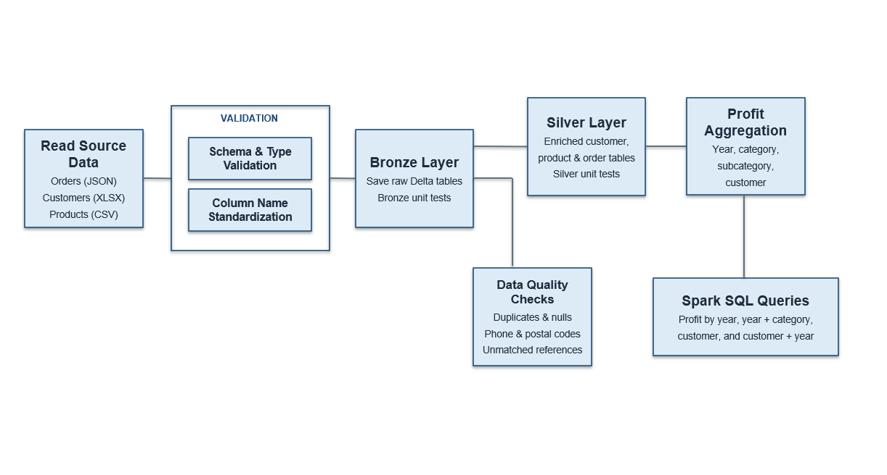

# pavan_cs-Data_Engineering-Assessment
PEI Group

## Prerequisite:
### Databricks
* Databricks Free Edition

### Install Required Python Package:
1. The openpyxl package is required to read Excel files into a PySpark DataFrame.
2. Run the following command in the first notebook cell:

    %pip install openpyxl==3.1.5

## Project Flow

1. **Import Required Packages**
   - Import Python, PySpark and openpyxl libraries.
   - Configure catalog, schemas and source file paths.

2. **Read Order Data (JSON)**
   - Standardize column names and validate the expected schema.
   - Perform data type casting for numeric and date columns.
   - Validate source data.

3. **Read Customer Data (XLSX)**
   - Read Excel data using 'openpyxl'.
   - Standardize column names and validate the expected schema.
   - Validate source data.

4. **Read Product Data (CSV)**
   - Standardize column names and validate the expected schema.
   - Cast product price to the required data type.
   - Validate source data.

5. **Create Bronze Delta Tables**
   - Save Orders, Customers and Products DataFrames as Delta tables.
   - Execute unit tests to validate table existence, schemas, data types and record counts.

6. **Perform Data Quality Checks**
   - Identify duplicate and null identifiers.
   - Identify missing important attributes.
   - Validate email addresses, phone numbers and postal codes.
   - Identify duplicate order lines and unmatched customer/product references.
   - Display data quality findings without modifying Bronze source records.

7. **Perform Customer Data Preprocessing**
   - Normalize customer names, email addresses and phone numbers.
   - Normalize and validate postal codes.
   - Handle invalid values by setting them to NULL.

8. **Create Enriched Silver Tables**
   - Create the enriched Customer and Product table.
   - Create the enriched Order table with customer and product details.
   - Calculate Profit rounded to two decimal places.
   - Execute unit tests to validate enriched tables.

9. **Create Profit Aggregation**
   - Join the required Bronze source tables.
   - Aggregate profit by Year, Product Category, Product Subcategory and Customer.
   - Save the results as a Silver Delta table.
   - Validate the aggregation results.

10. **Execute Spark SQL Queries**
    - Profit by Year.
    - Profit by Year and Product Category.
    - Profit by Customer.
    - Profit by Customer and Year.
    - Validate SQL aggregation outputs.

## Overview on the workflow:

